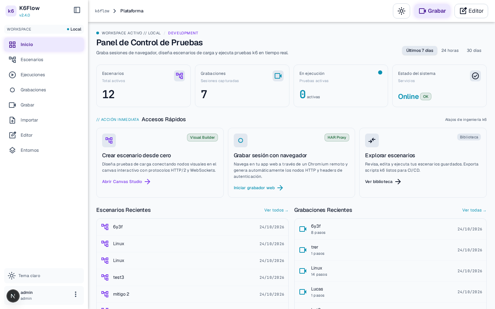
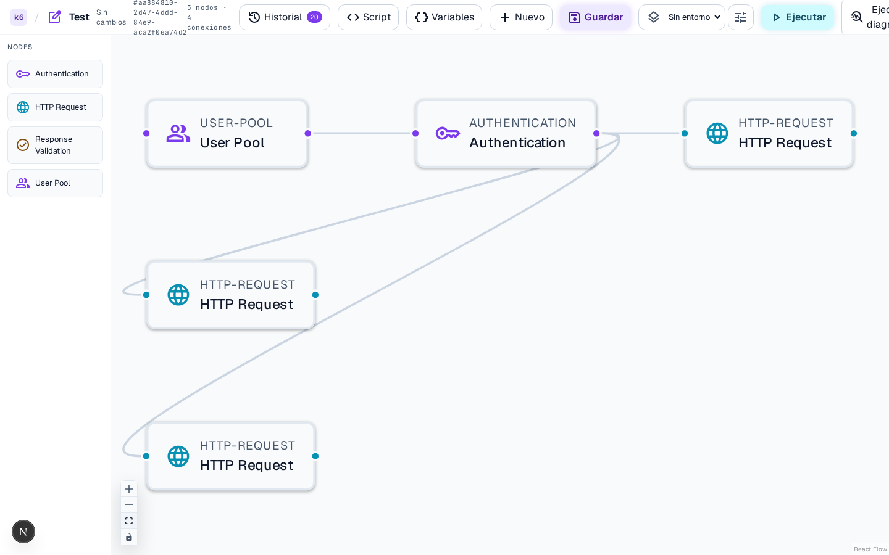
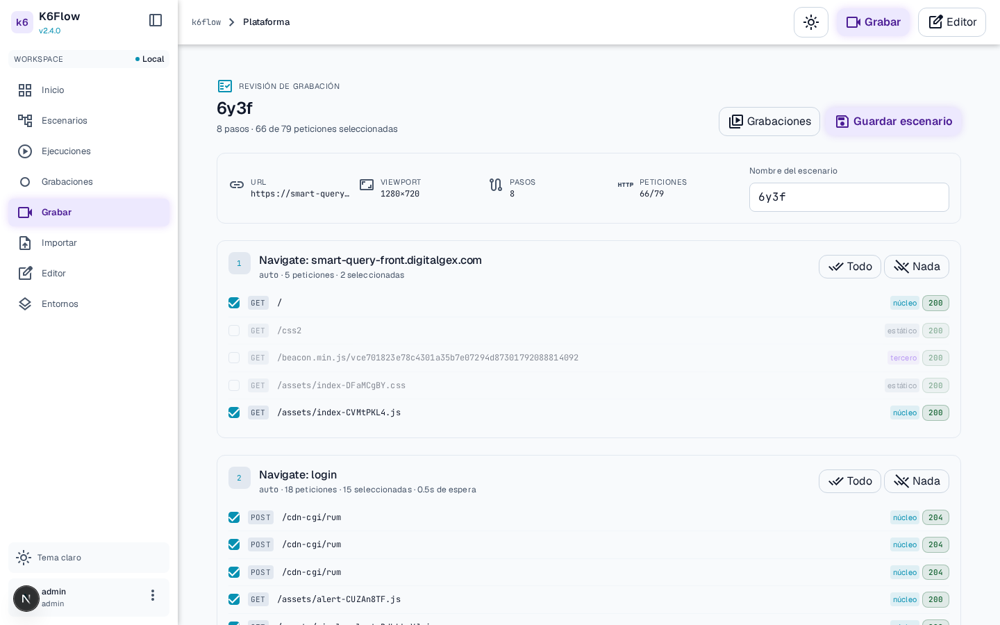
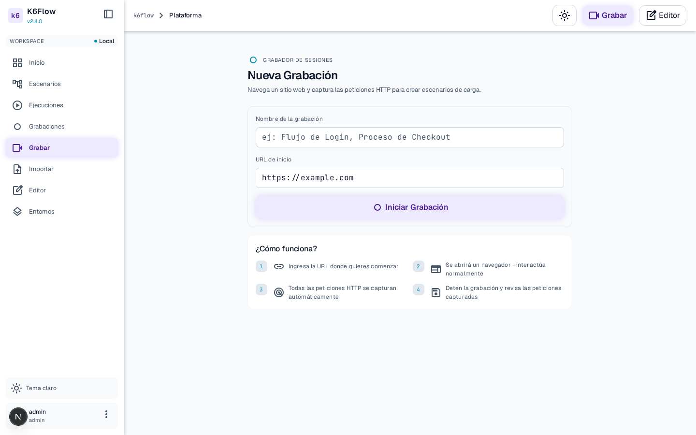
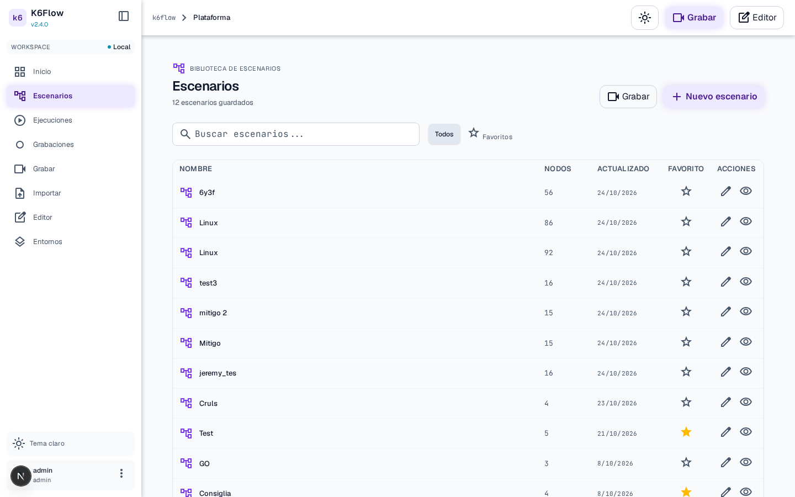
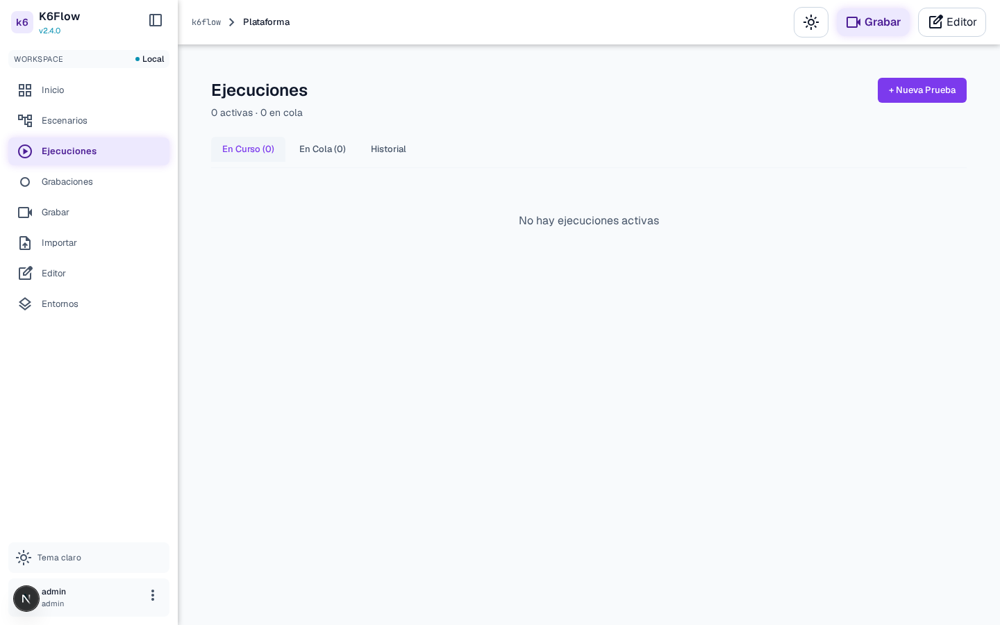

<div align="center">
  

  <h1>K6Flow</h1>

  <p><strong>Visual load testing for k6.</strong><br />
  Record a browser session, turn the captured traffic into a scenario, and run it with live metrics.</p>

</div>

<div align="center">

  [](https://github.com/jereok91/k6Flow/actions/workflows/ci.yml)
  [](https://github.com/jereok91/k6Flow/releases)
  [](https://github.com/jereok91?tab=packages&repo_name=k6Flow)
  [](LICENSE)

</div>

## Demo

The full loop in ~20 seconds: dashboard → recordings → review → editor.

[](docs/media/demo.webm)

## Screenshots

| | |
|---|---|
| <br /><sub><b>Dashboard</b> — scenario and recording counters, quick actions</sub> | <br /><sub><b>Editor</b> — request graph, script and history panels</sub> |
| <br /><sub><b>Recording review</b> — requests grouped by step, adjustable before saving</sub> | <br /><sub><b>Recorder</b> — start a browser session to capture traffic</sub> |
| <br /><sub><b>Library</b> — every scenario, its versions and last run</sub> | <br /><sub><b>Executions</b> — runs with live metrics per k6 container</sub> |

## Quick start

### Everything in one image (fastest)

The `k6flow` image already contains the web app, the orchestrator, the recorder and the
migrations. Only PostgreSQL goes next to it, the way yopass brings redis:

```bash
curl -O https://raw.githubusercontent.com/jereok91/k6Flow/main/deploy/docker-compose.all-in-one.yml
printf 'POSTGRES_PASSWORD=change-me\nADMIN_PASSWORD=change-me-min-12-chars\n' > .env
docker compose -f docker-compose.all-in-one.yml up -d
```

Two variants are published: `k6flow` (with the browser recorder) and `k6flow-slim` (same app
without Chromium, ~4x smaller). Pick the slim one with `K6FLOW_IMAGE=k6flow-slim` in `.env` when
you only need the editor, runs and HAR import.

### From the published images (one service per process)

Every `vX.Y.Z` tag also publishes `ghcr.io/jereok91/k6flow-{web,orchestrator,recorder,setup}` for
deployments that prefer one container per service.

```bash
curl -O https://raw.githubusercontent.com/jereok91/k6Flow/main/deploy/docker-compose.release.yml
printf 'POSTGRES_PASSWORD=change-me\nADMIN_PASSWORD=change-me-min-12-chars\nK6FLOW_VERSION=latest\n' > .env
docker compose -f docker-compose.release.yml up -d
```

Open <http://localhost:3000> and sign in with `ADMIN_USERNAME` / `ADMIN_PASSWORD`. The `setup`
service applies migrations and creates the admin before `web` starts.

Requirements: Docker with access to `/var/run/docker.sock` (the orchestrator launches one k6
container per run). See [docs/RELEASES.md](docs/RELEASES.md) for pinning versions and upgrading.

### Development

```bash
# Clone and setup
git clone https://github.com/jereok91/k6Flow.git
cd k6flow

# Start all services
docker compose --env-file deploy/.env.example \
  -f deploy/docker-compose.yml \
  -f deploy/docker-compose.dev.yml \
  up --build --wait

# Access the editor
open http://127.0.0.1:3000
```

Default admin credentials: `admin` / `change-me-min-12-chars`

### Production from source

See [docs/DEPLOYMENT.md](docs/DEPLOYMENT.md) for the full VPS deployment guide.

```bash
# Quick production deploy
cp deploy/.env.example deploy/.env
# Edit .env with your domain and passwords
docker compose -f deploy/docker-compose.yml -f deploy/docker-compose.prod.yml up -d
```

## Features

- **Visual Editor**: Drag-and-drop nodes to build test scenarios
- **Traffic Recorder**: Capture real HTTP traffic from an embedded browser and convert it to nodes
- **K6 Integration**: Translate visual graphs to K6 scripts automatically
- **Live Metrics**: Real-time VU counts, request rates, and latency percentiles
- **User Pools**: CSV-based test data for parameterized tests
- **Authentication**: Built-in auth nodes with token extraction
- **HAR import**: Turn an existing `.har` capture into a scenario

## Architecture

```
┌─────────────┐     ┌─────────────┐     ┌─────────────┐
│   Browser   │────▶│   Caddy     │────▶│    Web      │
│             │     │   (HTTPS)   │     │  (Next.js)  │
└─────────────┘     └─────────────┘     └──────┬──────┘
                                               │
                    ┌──────────────────────────┼───────────────┐
                    │                          │               │
                    ▼                          ▼               ▼
             ┌─────────────┐          ┌─────────────┐   ┌─────────────┐
             │  Recorder   │          │ Orchestrator│   │  PostgreSQL │
             │ (Node + PW) │          │    (Go)     │   │             │
             └─────────────┘          └──────┬──────┘   └─────────────┘
                                             │
                                             ▼
                                      ┌─────────────┐
                                      │ K6 Containers│
                                      │  (on-demand) │
                                      └─────────────┘
```

## Documentation

- [Releases](docs/RELEASES.md) — Cutting a version, published images, upgrades
- [Deployment Guide](docs/DEPLOYMENT.md) — Production installation
- [UI conventions](docs/UI.md) — Typography and icon rules
- [Architecture](docs/ARQUITECTURA.md) — System design decisions
- [API Reference](docs/api/) — REST and WebSocket contracts
- [Decisions](docs/DECISIONES.md) — Technical decisions and rationale

## Development

### Prerequisites

- Docker 24+ with Compose v2
- Node.js 22.22.0, pnpm 10.32.1 (for local tests)
- Go 1.26.10 (for local Go tests)

### Testing

```bash
# TypeScript tests (web + shared)
pnpm install --frozen-lockfile
pnpm test

# Recorder lifecycle tests (drive a real Chromium)
pnpm --filter @k6flow/recorder exec playwright install chromium
pnpm --filter @k6flow/recorder test

# Go tests
(cd apps/orchestrator && go test ./...)

# Type checking and linting
pnpm typecheck
pnpm lint
```

### Media for this README

The screenshots and the demo video are generated from the running app
(`scripts/capture-media.mjs`), never hand-cropped:

```bash
node scripts/capture-media.mjs   # needs CAPTURE_SESSION, see the header of the script
```

### Project Structure

```
k6flow/
├── apps/
│   ├── web/           # Next.js frontend + API
│   ├── orchestrator/  # Go service for K6 execution
│   └── recorder/      # Node + Playwright capture service
├── packages/
│   └── shared/        # TypeScript contracts and utilities
├── deploy/            # Docker Compose, release compose and Caddy configs
├── docs/              # Documentation and README media
└── tests/             # E2E tests
```

## Security

- **Allowed Targets**: Configure `ALLOWED_TARGETS` to restrict test destinations
- **Network Isolation**: K6 containers isolated from internal services
- **Credential Handling**: Passwords hashed, tokens secure, no secrets in logs

See [docs/DECISIONES.md](docs/DECISIONES.md) for detailed security practices.

## License

Apache License 2.0 — see [LICENSE](LICENSE).

Third-party obligations (LGPL-3.0 libvips, MPL-2.0 lightningcss, CC-BY-4.0 caniuse data and the
web fonts) are listed in [NOTICE](NOTICE).

## Contributing

Issues and pull requests are welcome. Branches follow `type/description` (`feat/`, `fix/`, …),
commits follow Conventional Commits, and `pnpm lint && pnpm test` must pass. Releases are cut by
pushing a `vX.Y.Z` tag (see [docs/RELEASES.md](docs/RELEASES.md)).
